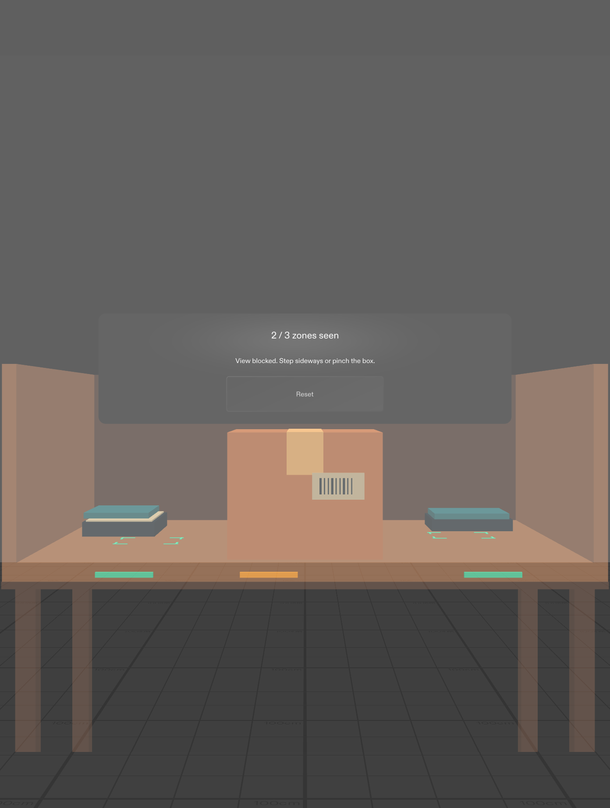
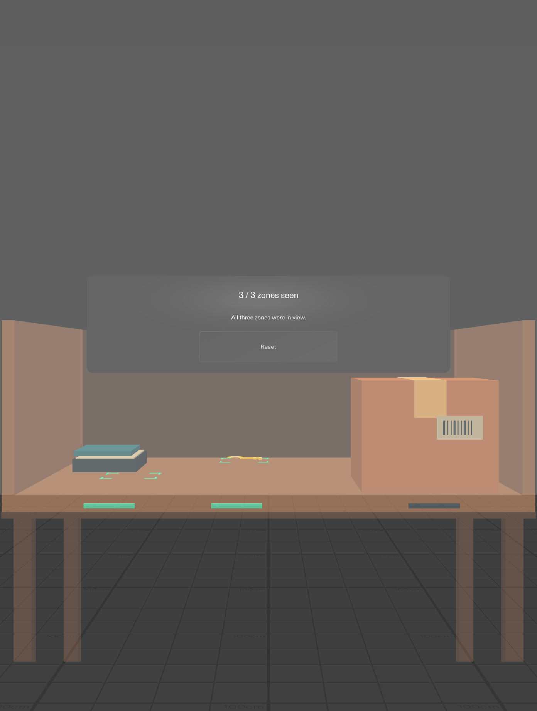

# Searchlight

Searchlight is a prototype Lens for people searching for a misplaced object in a cluttered space. As you look across a simulated shelf, small markers show which zones have been in view and which are still hidden. Move the box or look from the side to inspect what was behind it.

## Run the Lens

1. Open [Searchlight.esproj](Searchlight.esproj) in [Lens Studio 5.23.2](https://ar.snap.com/download/v5-23-2). The project includes the Specs Base Template scene, Spectacles Interaction Kit and Spectacles UI Kit.
2. In the Preview panel, select **SPECS 27** and **Interactive**, then choose the **Plane** preview environment if needed. Wait for the shelf to appear.
3. Click **Start search** in the Preview to simulate a pinch. Wait briefly for the two visible zones to register. An amber marker on the shelf lip and the **2 / 3 zones seen** count show that the center is blocked.
4. Click the cardboard box to slide it aside. The key comes into view and the count reaches **3 / 3**. You can also use **A/D** and mouse look to change your viewing angle. Click **Reset** to put the box back and clear coverage.

| Box in front | Box moved aside |
| --- | --- |
|  |  |

The Lens computes coverage from the Preview camera and the simulated box position. It tests five points in each zone and marks the zone as seen after the points stay in view and clear of the box for 0.75 seconds. The count describes camera coverage during this session. The box, shelf and key are simulated, and the Lens does not identify real objects or infer what a person noticed.

See the [design notes](devpost/design-brief.md) for the design decisions and validation scope. The Lens was developed with AI assistance, CLAD and the Lens Studio MCP. The Specs Base Template and bundled kit packages are third-party dependencies. See the [Specs samples license and notices](docs/specs-samples-license.md), [Specs Developer Terms](https://snap.com/en-US/terms/developer) and [Lens Studio License Agreement](https://snap.com/en-US/terms/lens-studio-license-agreement).
